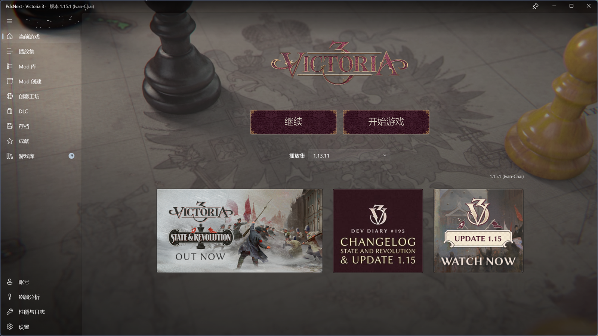
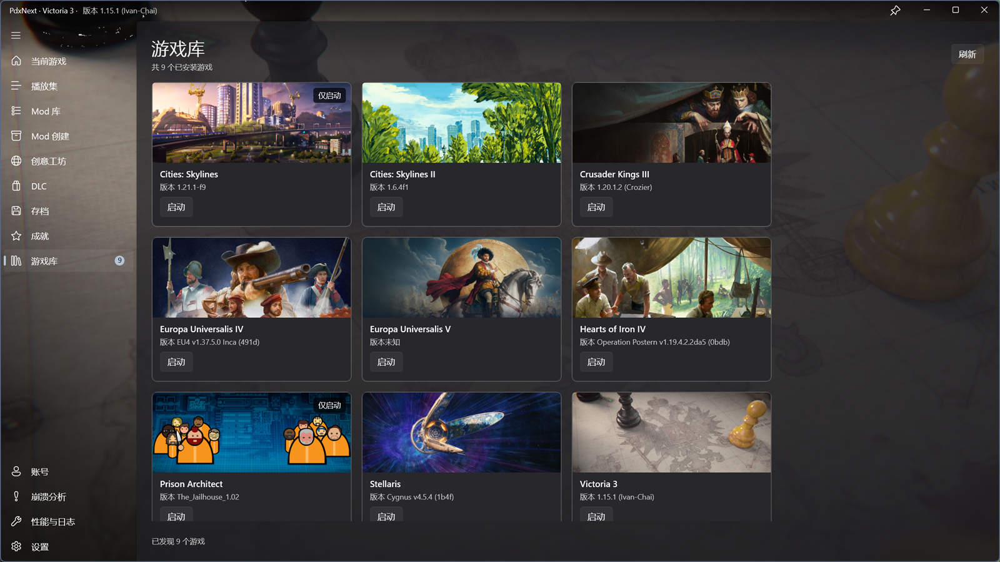
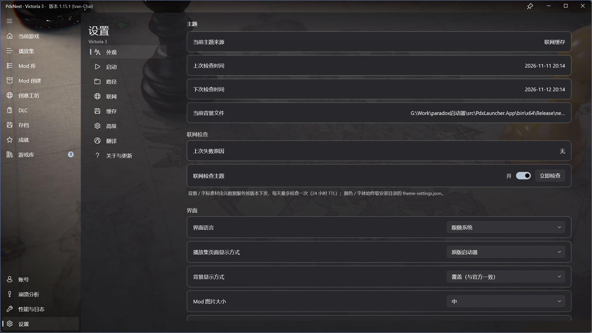

<p align="center">
  
</p>

<h1 align="center">PdxNext</h1>

<p align="center">Paradox 游戏启动器的原生重写：秒开、可离线、不碰官方目录。</p>

<p align="center">
  <a href="https://github.com/lyxc6/pdxnext/releases/latest"></a>
  <a href="https://github.com/lyxc6/pdxnext/actions/workflows/ci.yml"></a>
  <a href="LICENSE"></a>
  
  
</p>

---

## 这是什么

P 社官方启动器是 Electron 应用：要联网、要登录、冷启动慢。PdxNext 用 **WinUI 3 / .NET 10** 把它重新写了一遍，只做启动器真正该做的事——发现游戏、整理播放集与 Mod、开关 DLC、拉起游戏——并直接复用你机器上已有的游戏、Mod 与订阅，不重装游戏、不迁移数据、不写官方启动器的目录。

- **秒开**：原生界面，启动即用，不加载网页，不等账号校验。
- **可离线**：默认全程离线可用；联网只用于可选的公告、主题图、DLC 简介与 DLC 头图、创意工坊浏览。
- **干净**：自己的数据全写在程序目录 `data\` 下，官方启动器目录全程只读，两者可共存、随便来回切。

## 功能

**游戏发现与启动**
扫描 Steam 库（含所有附加库）与官方独立游戏库，按 `launcher-settings.json` 识别游戏，不需要维护 gameId 白名单。启动时从游戏目录拉起 exe；所有 Steamworks 调用都在短命子进程里执行，退出后 Steam 立刻除名，不会把主窗口登记成「游戏运行中」。

**播放集**
多播放集管理：新建 / 重命名 / 删除、启用禁用全部、上下移排序、点行首序号直接输入目标位次；缺路径、缺注册名、路径含非 ASCII 的行会单独标注，并可一键「修复 mod 路径」。改动即时保存，只有激活的播放集才写游戏加载文件（`dlc_load.json` / `content_load.json`）。

播放集页面有三种排布，在**设置 → 界面 → 播放集页面显示方式**里切换：
- **原版启动器**：单列当前播放集的 mod 列表，工具条右侧「添加模组」进入子页勾选添加。
- **双列（原版启动器式）**：左栏是还没加入该播放集的 mod，右栏是已加入的 mod；左栏勾选即加入（行立刻从左栏消失、出现在右栏末尾），右栏照旧用开关启用 / 禁用、↑↓ 调序、行尾图标移出。两栏各有独立的搜索框，中间的分隔条可以左右拖动改宽度（双击复位到 400 DIP）；窗口拉窄时左栏先让位，右栏始终保留够一行完整显示的宽度。
- **留空**：页面不显示内容（预留给后续自定义布局）。

**Mod 库**
本地 Mod 全量视图：来源徽标、大小、订阅时间、mod 自己声明的支持版本，以及真实 Steam 状态（已安装 / 有更新 / 下载中）。行内可直接打开工坊详情、本地目录或 Steam 页，也能让 Steam 下载、在本地禁用。

**创意工坊与 Mod 创建**
浏览、搜索、排序、按时间范围筛选创意工坊；「Mod 创建」页可新建描述符、编辑描述（BBCode 工具条 + 实时预览）、上传或更新条目，支持可见性、内容描述词、最多 8 张附加预览图、YouTube 视频预览与多语言标题描述。

**DLC**
按封面与简介列出游戏安装的全部 DLC，逐项开关后同步到加载文件；简介优先取游戏本地描述，缺省时联网按 appid 补全并缓存。除本地清单里的已拥有项外，还会列出 Steam 报告里未拥有的 DLC（只读、不给开关），列表按「已拥有 / 未拥有」两段展示；Steam 没运行时未拥有段只给一句说明，CS2 这种列表本就由 Steam 全量给全的游戏不分段。封面头图按 appid 从 Steam 商店的 `header_image` 取回，缓存到 `data\dlc-artwork\`，URL 有效 14 天，单张取不到只影响那一张图。

**存档管理**
CK3、VIC3、EU5、Stellaris 与 CS2 各有自己的存档落点（文档下的 Paradox 目录、`LocalLow` 下的 Colossal Order 目录），按游戏逐个浏览。页面两段式加载：先出行（文件名、大小、修改时间），再逐行补上游戏内日期、版本、玩家与国家——只读容器头部的有限字节，不整份解析几十 MB 的 `gamestate`，扫描期间不闪「没有存档」。每份存档可备份进启动器的 `data\save-backups\`（`.bak` 正文 + 同名 `.bak.json` 清单，中文名原样保留；总量 2 GiB 配额，满了只提示、不自动删）。恢复默认在存档目录里新建一份带「(恢复 日期-时间)」后缀的副本，现有存档不被覆盖；删除真实存档不会直接删文件，而是移进 `data\save-backups\trash\` 回收区；「清理旧备份」只在你点击时执行，保留最新 10 份，其余连同孤儿备份一起清掉。

**成就**
接 Steam 成就：一行一条，带解锁时间与全球解锁率，页头「已解锁 X / Y」始终按整份成就统计；可按「全部 / 已解锁 / 未解锁」筛选，也能直接搜关键词。成就名与描述按**游戏自己的语言**取自安装目录的 `localization\<lang>\*_l_<lang>.yml`（`ACHIEVEMENT_<apiName>` / `ACHIEVEMENT_DESC_<apiName>`）——Steamworks 的显示名跟的是每游戏语言、不跟客户端语言，否则就会出现启动器英文、游戏里中文的分裂；语言先读游戏设置里的 `language`，再回落界面语言与 `english`。图标直接读安装目录的 `gfx\interface\icons\achievements`，未解锁优先用 `_notachieved` 版本，只有 DDS 的（如 CK3）先解码成 PNG 再显示，全程不联网。

**外观与体验**
读取游戏自己的主题（背景图、配色、字体、按钮样式）并铺满整个窗口；支持窗口置顶、跟随系统亮暗主题。全中文界面，创意工坊与 Mod 的名称 / 简介 / 更新日志 / 评论可在线翻译——自填 OpenAI 兼容接口、微软翻译、谷歌云翻译、谷歌免费翻译四档，可固定档位或自动回落。

**数据与网络**
代理支持直连 / 跟随系统 / 手动三档，改完立即生效；联网请求按站点限速并缓存结果，断网时优先用旧副本。

## 截图

<p align="center">
  
</p>

<p align="center"><sub>当前游戏：把游戏自己的主题背景铺满整窗，「继续 / 开始游戏」一步到位。</sub></p>

<p align="center">
  
  
</p>

<p align="center"><sub>左：游戏库——扫描到的游戏以卡片列出，右上角标注支持等级；右：设置——主题、界面语言、播放集布局，联网 / 翻译 / 缓存各有独立页签。</sub></p>

## 下载与安装

到 [Releases](https://github.com/lyxc6/pdxnext/releases/latest) 下载最新的 `PdxNext-Setup-<版本>.exe`（自包含，约 80 MB）。

- 系统要求：Windows 10 1809+ 或 Windows 11，仅 x64。
- 无需预装 .NET 运行时，依赖已随包自带。
- 默认按用户安装，不需要管理员（装到 `%LOCALAPPDATA%\Programs\PdxNext`）；也可选择全机安装。
- 程序数据在安装目录的 `data\`，卸载不会删除，彻底清理需手动删掉该目录。
- 进程名是 `PdxLauncher.App.exe`（历史命名），任务管理器里看到它即本程序。

启动器内置自动更新：检查 GitHub Releases 的 `update.json`（24 小时节流），下载后校验 SHA-256 再按安装模式静默升级；也可以直接下载新安装包覆盖安装。

## 快速上手

1. 打开**游戏库**，选中要玩的游戏（首次启动会扫描 Steam 库与官方独立库）。
2. 到**播放集**新建一个，点「添加模组」从 Mod 库挑选，勾选并排好顺序；也可以把页面切成「双列」，直接在左栏勾选可添加的 mod。
3. 回到「当前游戏」点「开始游戏」；DLC 在 **DLC** 页开关，其余选项在**设置**里。

## 从源码构建

```bat
git clone https://github.com/lyxc6/pdxnext.git
cd pdxnext
start.cmd
```

- 需要 .NET SDK 10 与 Windows 10/11 SDK；Windows App SDK 以自包含方式随包，无需单独安装。
- 仓库的 `NuGet.config` 清空了默认源、按全离线构建，依赖必须已在本机 NuGet 缓存中，细节见 [docs/DEVELOPMENT.md](docs/DEVELOPMENT.md)。
- 产物在 `bin\x64\Release\net10.0-windows10.0.26100.0\win-x64\`，**分发时要整个目录一起拷**，只拷 exe 会起不来。
- 自检程序 `tests/PdxLauncher.Checks` 覆盖 166 个检查类；CI 见 [`.github/workflows/ci.yml`](.github/workflows/ci.yml)。

## 兼容性

| 游戏 | 支持程度 |
| --- | --- |
| Crusader Kings III、Victoria 3、Stellaris | 完整：启动 + 播放集 / Mod 库 / DLC + 加载文件 |
| Cities: Skylines、Prison Architect | 仅启动：Mod 与 DLC 交给游戏本体 |
| 其它带 `launcher-settings.json` 的 Paradox 游戏 | 基础：能被发现与启动，内容管理未适配 |

已知限制（完整清单见开发文档）：不做 Paradox 账号登录，Mod 订阅列表只读本地库；不扫描 Epic / GOG 等其他平台；Steam DRM 游戏仍需 Steam 在线；代理仅支持 HTTP / HTTPS。

## 文档

| 文档 | 内容 |
| --- | --- |
| [docs/DEVELOPMENT.md](docs/DEVELOPMENT.md) | 构建、离线依赖、安装包与自动更新、实现细节、目录结构、自检、数据隔离、完整限制与排错 |
| [docs/DATA-FORMATS.md](docs/DATA-FORMATS.md) | 各类数据格式的真机实测记录（加载文件、描述符、sqlite 表结构等） |
| [docs/INSTALLER.md](docs/INSTALLER.md) | 安装包、自动更新与发布流程 |
| [docs/UI-SPACING.md](docs/UI-SPACING.md) | UI 间距规范：4px 网格、官方常用值、检查器与历史映射 |
| [docs/VERSIONING.md](docs/VERSIONING.md) | 版本号规则 |
| [CHANGELOG.md](CHANGELOG.md) | 变更日志 |

## 免责声明

PdxNext 是非官方项目，与 Paradox Interactive 及任何游戏发行商无关，也不代表其立场。

- 不提供、不分发游戏本体、DLC 内容、账号或密钥；游戏名称、图标、封面等素材版权归各自所有者。
- 可选的「一键打补丁」（CreamAPI 式 Steamworks 代理 DLL）默认不启用，只在你主动点击时写入**本机**游戏目录，用于整理已安装的内容；是否使用及由此产生的后果由你自行承担，并可能违反相关服务条款。
- 自有代码按 MIT 许可发布，第三方素材不在 MIT 覆盖范围内。

## 许可证

[MIT](LICENSE) © 2026 PdxNext

遇到问题或有建议，欢迎开 [Issue](https://github.com/lyxc6/pdxnext/issues)。
